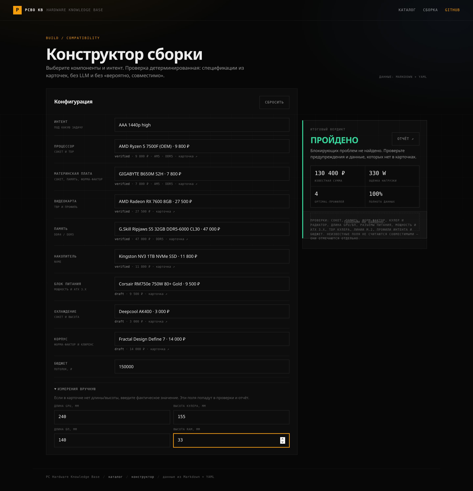
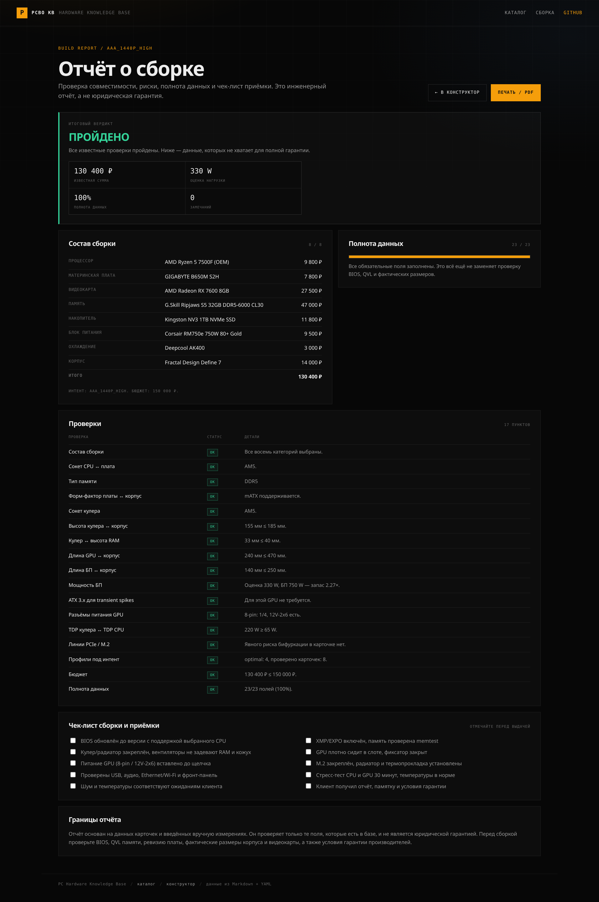

# PC Hardware Knowledge Base

**Файловая база знаний о компьютерном железе для людей и LLM.**

[](#быстрый-старт)
[](#что-внутри)
[](#покрытие)
[](LICENSE)

---

## Зачем

Я собрал эту базу для себя. Когда сравниваешь процессоры, платы, память и
видеокарты, приходится держать в голове сокеты, VRM, TDP, тайминги, линии PCIe
и цены. А если спрашиваешь LLM — он уверенно выдумывает половину характеристик.

Здесь то же самое, но в виде файлов:

- одна карточка — один компонент;
- параметры, источники и дата проверки зафиксированы;
- связи между компонентами, концептами и интентами — явные;
- поведение под конкретную задачу описано профилями, а не тегами «хорошо/плохо»;
- всё лежит в Markdown + YAML и читается без базы данных.

Делюсь как есть. Это не продукт и не сервис, а рабочий справочник, который я
постепенно наполняю.

---

## Чем это не является

- **Не магазин и не агрегатор цен.** Цены — снимок рынка на дату в карточке.
- **Не обзорный сайт.** Нет рейтингов «топ за свои деньги».
- **Не рекомендательный движок.** База описывает свойства и ограничения;
  решение остаётся за человеком.
- **Не бенчмарк-лаборатория.** Цифры производительности взяты из открытых
  источников и помечены как оценки.

---

## Что внутри

```text
catalog/
  cpu/                 24 карточки: Zen 4/5, Arrow Lake, Raptor Lake, Alder Lake
  gpu/                 15 карточек: RTX 50/40, RX 9000/7000, Arc B
  motherboard/         22 карточки: AM5, LGA1700, LGA1851
  memory/              8 карточек: DDR5 и DDR4
  storage/             9 карточек: NVMe Gen4/Gen5
  psu/                 10 карточек: ATX 3.x и ATX 2.x
  cooling/             10 карточек: воздух и СЖО
  case/                5 карточек
  audio-interface/     8 карточек: RME, MOTU, Focusrite, UA
  intents/             6 YAML-сценариев сборки
concepts/              14 сквозных концептов
scripts/               query, профили, физические проверки, подбор
references/            схемы и выгрузки спецификаций
docs/                  narrative arcs и рабочие материалы
```

**111 карточек компонентов, 6 интентов и 14 концептов.** У 97 карточек есть
профили поведения (54 уникальных профиля).

Отдельно стоит аудио-домен: 8 интерфейсов, классификация драйверов T0–T3,
концепт DPC latency и интент `daw_zero_dpc_latency`. Это не «ещё одна категория»,
а другой набор ограничений: задержка важнее FPS.

---

## Веб-приложение

Поверх базы есть SvelteKit-приложение: каталог с фильтрами, конструктор сборки
и отчёт для приёмки у клиента.

**Демо:** https://kaizin-lab.github.io/pc_hardware_knowledge_base/ — после включения GitHub Pages.

- сокет CPU ↔ плата, тип памяти, форм-фактор, кулер/радиатор, длина GPU и БП;
- разъёмы питания GPU, мощность БП и ATX 3.x, TDP кулера, линии M.2;
- профили `optimal` / `failure` под выбранный интент;
- вкладка «Производительность»: Cinebench R23, Blender, 7-Zip, компиляция,
  эффективность и цена/производительность по каждой нагрузке;
- ручные измерения, полнота данных и честные `INFO` для неизвестных полей;
- отчёт с BOM, проверками, рисками, чек-листом приёмки и печатью в PDF.

[](webapp/screenshots/build.png)

[](webapp/screenshots/report.png)

[Скриншот вкладки «Производительность»](webapp/screenshots/performance.png)

```bash
cd webapp
npm install
npm run dev
```

Подробности — в [`webapp/README.md`](webapp/README.md). Деплой на GitHub Pages
настроен через Actions; в настройках репозитория нужен **Pages → Source:
GitHub Actions**.

> Если сайт отдаёт 404: проверьте, что Pages собран не из ветки `/docs`.
> Сейчас проект должен использовать **Source: GitHub Actions**, а не
> «Deploy from a branch».

---

## Быстрый старт

```bash
git clone https://github.com/kaizin-lab/pc_hardware_knowledge_base.git
cd pc_hardware_knowledge_base

python3 -m venv .venv
source .venv/bin/activate
pip install -r requirements.txt
```

### Поиск по каталогу

```bash
python scripts/query.py --list-types
python scripts/query.py --type gpu
python scripts/query.py --vendor amd --type cpu
python scripts/query.py --tag am5
python scripts/query.py --links-to catalog/memory/ddr5.md
python scripts/query.py --id amd-ryzen-7-7800x3d
```

Скрипт печатает пути к файлам. Дальше открываете нужный Markdown — или отдаёте
путь LLM.

### Профили под задачу

```bash
python scripts/evaluate_profiles.py --intents "esports_1080p_240hz" --type gpu
python scripts/evaluate_profiles.py --intents "llm_inference_13b" --type gpu
python scripts/evaluate_profiles.py --check-transitivity
```

Пример:

```text
# Оценка профилей для интентов: ['esports_1080p_240hz']

## NVIDIA GeForce RTX 5070 12GB (catalog/gpu/nvidia-rtx-5070.md)
  ✓ optimal: balanced_performance_gpu → ['esports_1080p_240hz']

# Сводка
  Оптимальных совпадений: 11
  Предупреждений (WARN):  0
  Блокировок (BLOCK):     0
```

### Проверка целостности

```bash
python scripts/check_links.py
```

Проверяет YAML, дубликаты ключей, битые `links:`, относительные Markdown-ссылки
и наличие `index.md` в каждой директории.

---

## Модель данных

Каждая карточка — Markdown с YAML frontmatter:

```yaml
---
id: "amd-ryzen-7-7800x3d"
type: "cpu"
title: "AMD Ryzen 7 7800X3D"
vendor: "amd"
status: "draft"
tags: ["amd", "zen4", "am5", "ddr5", "3d-v-cache", "120w"]
last_updated: "2026-06-03"
links:
  platform: "catalog/motherboard/am5/index.md"
  memory_type: "catalog/memory/ddr5.md"
  family: "catalog/cpu/amd-ryzen-7000.md"
  concepts:
    - "concepts/3d-v-cache.md"
    - "concepts/power-budget.md"
specs:
  socket: "AM5 (LGA1718)"
  cores: 8
  threads: 16
  tdp: "120W"
  l3_cache: "96 MB"
price_ru:
  min: 42000
  median: 48000
  max: 55000
  source: "price.ru"
  date: "2026-06-04"
profiles:
  cache_dominant_gaming:
    capability_level: 3
    optimal_for_intents: ["esports_1080p_240hz", "esports_1080p_360hz"]
    failure_for_intents: ["3d_rendering_cpu"]
    failure_severity: "WARN"
---
```

Дальше — обычный текст: позиционирование, характеристики, поведение,
ограничения, альтернативы.

### Статусы

| Статус | Значение |
|---|---|
| `draft` | Данные собраны, но не проверены вторым проходом |
| `review` | Проверяется, возможны правки |
| `verified` | Можно ссылаться как на актуальную карточку |

Сейчас: **21 verified, 90 draft**. `draft` — не «плохо», а «ещё не вычитано
вторым проходом».

---

## Профили и интенты

Тег «хорошо для игр» ничего не значит. Профиль описывает:

1. при каких условиях компонент оптимален;
2. где он ломается;
3. насколько это критично — `WARN` или `BLOCK`.

```yaml
profiles:
  balanced_performance_gpu:
    power_envelope: "mid"
    capability_level: 2
    steel_man_desc: "Предсказуемое масштабирование. ATX, БП 600–750W."
    failure_mode_desc: "Не специализирован: проигрывает enthusiast в 4K и low-power в SFF."
    optimal_for_intents: ["aaa_1440p_high", "aaa_1080p_ultra", "esports_1080p_240hz"]
    failure_for_intents: ["aaa_4k_path_tracing"]
    failure_severity: "WARN"
    failure_type: "LINEAR_DEGRADATION"
```

Профили проверяются пересечением множеств: `intents пользователя ∩
optimal_for_intents`. Без LLM и без вероятностей.

Есть два уровня интентов:

- **6 YAML-сценариев** в `catalog/intents/` — верхнеуровневые цели сборки
  (AAA, AI inference, data engineering, esports, SFF, DAW).
- **26 ID в словаре профилей** — конкретные режимы для матчинга компонентов
  (разрешение, модель, характер нагрузки).

Полный словарь — в
[`concepts/epistemological-profiles.md`](concepts/epistemological-profiles.md).

---

## Принципы

**Один компонент — один файл.** Легко диффить, ссылаться и точечно обновлять.

**Progressive disclosure.** В каждой директории есть `index.md` с картой и
ключами. Сначала читается индекс, потом нужная карточка.

**Связи явные.** `links:` ведёт к сокету, памяти, семейству, концепту или
интенту. Граф можно обойти без полнотекстового поиска.

**Источник и дата.** У цен есть `source` и `date`. Если дата старая — это видно.

**Iron Man Argument.** Карточка объясняет, где компонент силён и где проигрывает,
а не собирает соломенное чучело.

**Markdown вместо базы данных.** Всё диффится в git, читается человеком и
загружается LLM без коннекторов.

---

## Покрытие

| Категория | Карточек | Состояние |
|---|---|---|
| CPU | 24 | Zen 4/5, Arrow Lake, Raptor Lake, Alder Lake |
| GPU | 15 | RTX 50/40, RX 9000/7000, Arc B |
| Материнские платы | 22 | AM5 (11), LGA1700 (9), LGA1851 (2) |
| Память | 8 | DDR5 и DDR4, включая бюджетные комплекты |
| Накопители | 9 | NVMe Gen4/Gen5 |
| БП | 10 | ATX 3.x и ATX 2.x |
| Охлаждение | 10 | Воздух и СЖО |
| Корпуса | 5 | Mesh и sound-dampened |
| Аудиоинтерфейсы | 8 | T0–T3, USB и Thunderbolt |
| Мониторы | 0 | Только индекс, карточек нет |

---

## Ограничения

- **Цены устаревают.** Снимок рынка РФ на июнь 2026. Перед покупкой проверяйте
  актуальную цену и наличие.
- **90 карточек в `draft`.** Данные есть, вычитка не завершена.
- **Мониторы не покрыты.** Индекс есть, карточек нет.
- **Есть 3 предупреждения транзитивности профилей.** `evaluate_profiles.py
  --check-transitivity` показывает их: одинаковый профиль у разных корпусов
  описывает разные intents. Это известная проблема, а не скрытая.
- **Нет бенчмарк-лаборатории.** Все цифры FPS — оценки из открытых источников.
- **Не рекомендация к покупке.** База помогает думать, а не заменяет инженера.

---

## Планы

1. Закрыть мониторы: 3–5 типовых моделей.
2. Убрать предупреждения транзитивности профилей.
3. Добавить шаблон карточки и чек-лист ревью.
4. Подключить `check_links.py` в CI.
5. Расширить аудио-домен: ещё 3–5 интерфейсов и микрофоны.
6. Актуализировать цены и перевести больше карточек в `verified`.

---

## Участие

База личная, но issues и pull requests открыты. Полезнее всего:

- исправление фактических ошибок со ссылкой на источник;
- актуализация цен с датой и ссылкой;
- новые карточки по текущей схеме;
- улучшение профилей и словаря интентов.

Перед PR:

```bash
python scripts/check_links.py
python scripts/evaluate_profiles.py --check-transitivity
```

Конвенции: имена файлов `vendor-model.md`, пути в `links:` от корня репозитория,
Markdown-ссылки относительно файла, `index.md` обязателен в каждой директории,
статус `verified` — только после проверки.

---

## Связанные проекты

- [`jefo/pc-build-ontology`](https://github.com/jefo/pc-build-ontology) —
  онтология и детерминированные валидаторы сборок, которые используют эту базу.
- **«Железный Аргумент» / ИгроЛаба** — контент-проект, из которого выросла база.

---

## Лицензия

MIT. См. [`LICENSE`](LICENSE).
